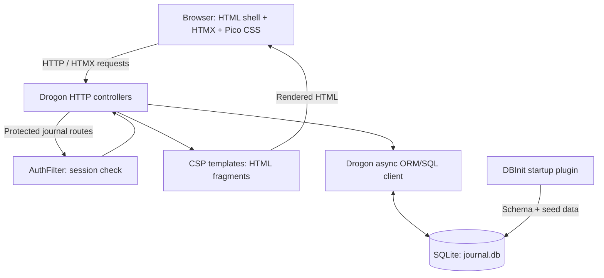
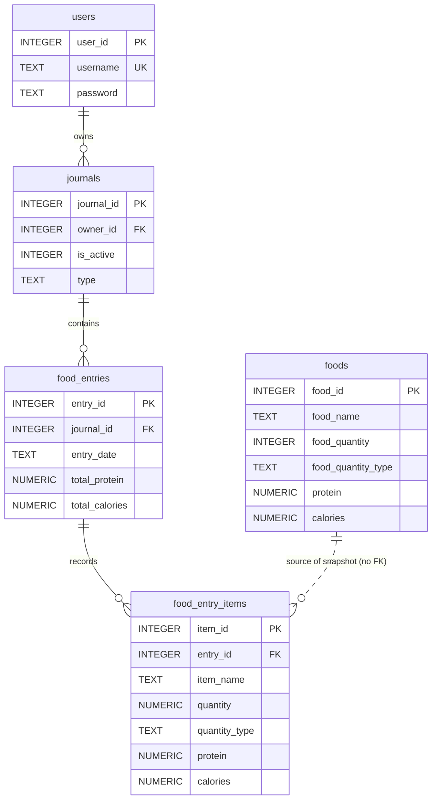

# Architecture and data model

Fit Journal is a **server-driven web application**. Rather than shipping a separate SPA or exposing a JSON-focused REST API, it combines Drogon's HTTP controllers, CSP-generated HTML, and HTMX partial-page updates.

## Request flow



### Server responsibilities

- **`src/main.cc`** loads `../config.json`, calls `enableSession(12000)`, and runs Drogon.
- **`src/controllers/UserCtrl.*`** handles sign-up, sign-in, sign-out, and authorization-view rendering.
- **`src/controllers/JournalCtrl.*`** lists journals, displays entries, creates entries, and adds/deletes food-entry items.
- **`src/controllers/FoodCtrl.*`** provides catalog browsing, search, and item selection.
- **`src/filters/AuthFilter.*`** checks the `loggedIn` session flag before allowing journal requests.
- **`src/database/DbManager.h`** supplies food-catalog queries using Drogon's coroutine database client. It is a small singleton helper, not a general repository layer.
- **`src/plugins/DBInit.*`** applies SQLite PRAGMA settings, creates schema objects, and seeds the catalog at application startup.
- **`src/dto/*.h`** converts SQL rows into C++ structs passed to views.
- **`src/views/*.csp`** renders HTML from the DTOs; **`static/`** supplies the page shell, styles and HTMX.

## Data model



The relationship from `foods` to `food_entry_items` is **conceptual only**: there is no foreign key. An added food is copied into `food_entry_items` as a snapshot instead of referring back to the source catalog record.

### Tables

| Table | Role | Important details |
| --- | --- | --- |
| `users` | Credentials | Unique username; `password` stores bcrypt hash |
| `journals` | User-owned journal definitions | Type is plain text, `is_active` governs list visibility |
| `food_entries` | Dated food logs | Each belongs to a journal and stores aggregate totals |
| `food_entry_items` | Foods logged for one entry | Stores calculated quantity, protein and calories |
| `foods` | Shared reference catalog | Startup plugin inserts example products/foods |

A trigger named `add_journal_for_new_user` creates three journal records when a user is inserted: active `food`, inactive `life`, and inactive `sport`. The latter two do not have corresponding working journal features.

### Daily-entry uniqueness

The intended domain model treats an entry as a day's food log within one journal. However, **the checked-in SQLite schema has no `UNIQUE (journal_id, entry_date)` constraint**, and `create_entry` performs an unconditional `INSERT`. Therefore the current implementation permits duplicate entries for the same date. A uniqueness constraint and friendly conflict handling are recommended.

## Nutrition calculation

Catalog records provide nutritional values for a **base quantity**, such as an item per 100 g. The interface takes an `amount` multiplier when recording it. For a selected food:

```text
logged_quantity = catalog_quantity * amount
logged_protein  = catalog_protein  * amount
logged_calories = catalog_calories * amount
```

`Journals::add_food_item` reads the source catalog row, calculates these values, and inserts an independent row into `food_entry_items`.

Two SQLite triggers keep each entry's stored totals synchronized:

- **`update_entry_totals`**: `AFTER INSERT ON food_entry_items` adds the new item's protein/calories to its parent entry.
- **`update_entry_totals_on_delete`**: `AFTER DELETE ON food_entry_items` subtracts the deleted item's protein/calories.

The `get_entry` handler independently sums the returned item rows for display, whereas the journal overview reads the stored totals from `food_entries`. There is **no UPDATE trigger** because editing an existing item has not been implemented.

The DTOs use floating-point values (`float`) for nutritional measurements. This is adequate for a prototype, but may produce rounding artifacts; add input rules and consistent numeric precision as the application develops.

## Authentication and authorization

Password creation and verification use the vendored bcrypt library. Successful sign-in stores `loggedIn`, `ID`, and `username` in a Drogon session; logout erases those keys. Journal routes are protected by `AuthFilter`.

**Important distinction:** the filter checks **authentication only**, not whether an individual requested journal, entry, or item belongs to that user. For example, `get_journal` reads by `journal_id` without joining to `journals.owner_id`. Several mutation endpoints accept arbitrary IDs without ownership checks. This is an insecure direct object reference (IDOR) risk and must be fixed before public hosting. See [Limitations](LIMITATIONS.md).

## Initialization and persistence

`config.json` sets a single SQLite connection (`number_of_connections: 1`). The `DBInit` plugin executes `PRAGMA foreign_keys = ON`, creates tables and triggers using `IF NOT EXISTS`, then deletes and reloads the `foods` table. The source comment correctly observes that SQLite PRAGMA settings are **per connection**; keeping one connection avoids the incomplete multi-connection strategy in the current code.

`sql/schema.sql` is a reference copy of the schema. The application **does not load this SQL file on startup**; the schema is duplicated as SQL strings in `src/plugins/DBInit.cc`, creating the possibility of divergence. The application uses `journal.db` relative to its working directory. The Dockerfile does not currently define a persistent volume for this file.

## Key implementation tradeoffs

- **Drogon + CSP + HTMX** keeps the client simple and avoids a separate SPA/API build. The cost is tighter coupling of controllers, server-rendered views, and HTMX response conventions.
- **SQLite** simplifies local setup and deployment. Current use is single-connection; concurrency and migration strategy would need deliberate attention if expanded.
- **SQL triggers** make insert/delete total maintenance automatic, but correctness must also cover future updates and concurrent transactions.
- **Nutrition snapshots** preserve historic log values when catalog records change, which is appropriate for a journal.

For routes and payloads, see [HTTP routes](HTTP_ROUTES.md).